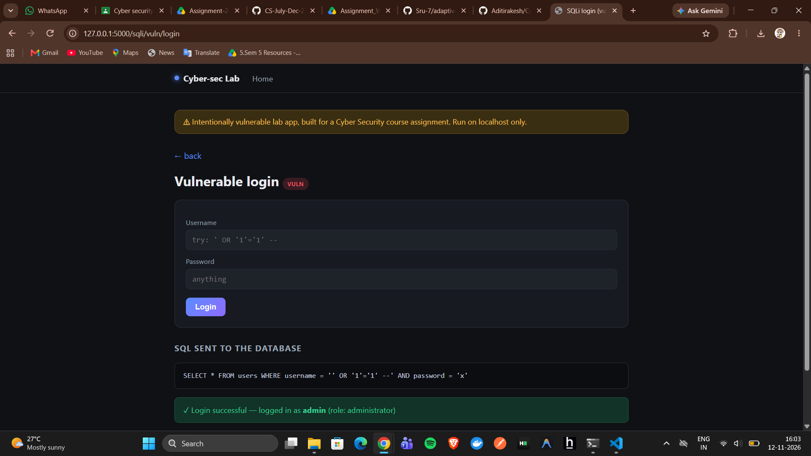
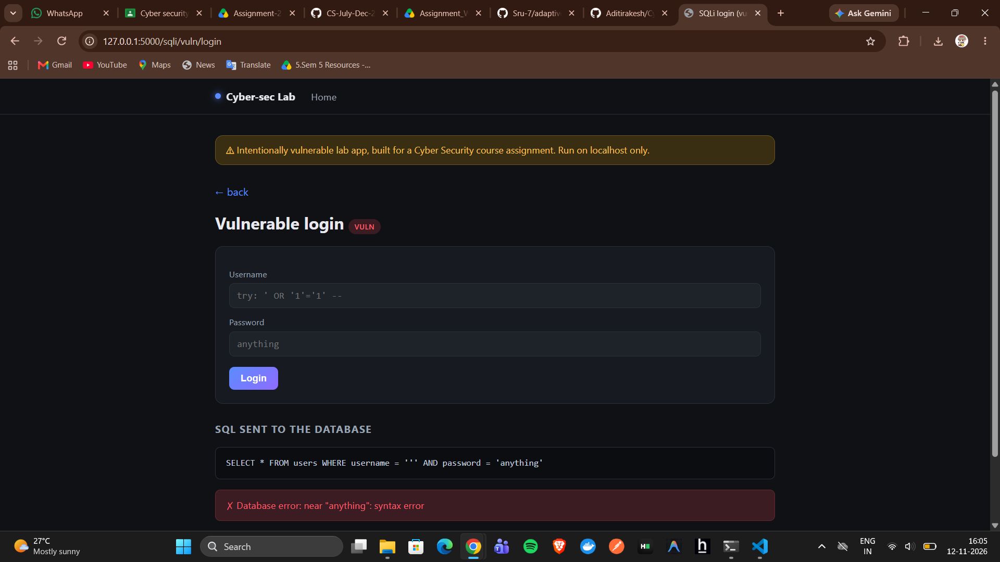
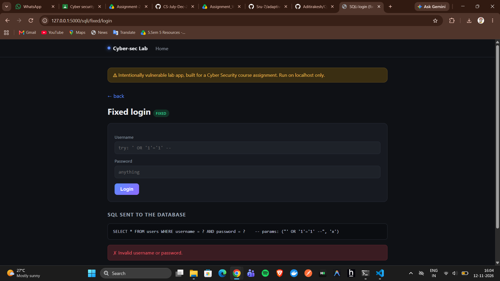
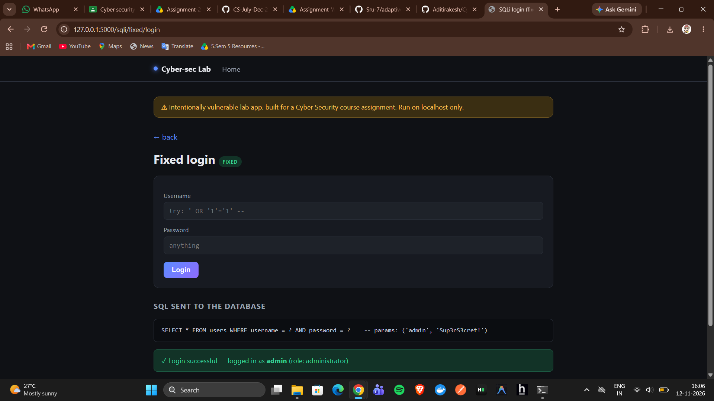

# M1: SQL Injection - Authentication bypass (Aditi)

## (a) Vulnerable implementation
`modules/sqli.py`, function `vuln_login()`, route `/sqli/vuln/login`.
The query is built by string concatenation:

```python
query = "SELECT * FROM users WHERE username = '" + username + \
        "' AND password = '" + password + "'"
```

## (b) Working exploit
Open `http://127.0.0.1:5000/sqli/vuln/login`.

| Username | Password | Result |
|---|---|---|
| `' OR '1'='1' --` | anything | logged in as first user (admin) |
| `admin' --` | (empty) | logged in as admin, password check skipped |

Resulting SQL for the first payload:
```sql
SELECT * FROM users WHERE username = '' OR '1'='1' --' AND password = 'x'
```
`OR '1'='1'` is always true and `--` comments out the password check.



A lone `'` as the username triggers a raw database error on the vulnerable
route, which also leaks information about the query structure to an
attacker:



## (c) Root cause
User input is concatenated into the SQL string, so the database cannot tell
the developer's query structure from attacker-supplied data. The attacker's
quote characters change the logic of the query.

## (d) Mitigation implemented: parameterised queries
`fixed_login()` at `/sqli/fixed/login`:

```python
query = "SELECT * FROM users WHERE username = ? AND password = ?"
conn.execute(query, (username, password))
```
The query structure is compiled first and the input is passed separately as
data, so the same payload is treated as a literal (non-existent) username and
the login fails. The fixed route also returns a generic error message.



The fix does not break normal functionality: logging in with the real
username and password still succeeds on the fixed route.



## (e) Other mitigations (theory)
- **Input validation with allow-lists:** accept only what is expected (for
  example usernames matching `^[A-Za-z0-9_]{3,20}$`) and reject the rest.
  Quotes and SQL keywords never reach the query. It is a second layer, not a
  replacement for parameterisation, because some fields (names, comments)
  legitimately contain special characters.
- **Least-privilege database accounts:** the web app connects with an account
  that has only the rights it needs (for example SELECT/INSERT on specific
  tables, no DROP, no access to other schemas or file functions). If an
  injection still succeeds, the damage is limited.
- **Safe errors:** show users a generic message and log details server-side.
  Verbose database errors reveal table names, query structure and the DBMS,
  which helps an attacker craft payloads (the `'` payload on the vulnerable
  route shows this).
