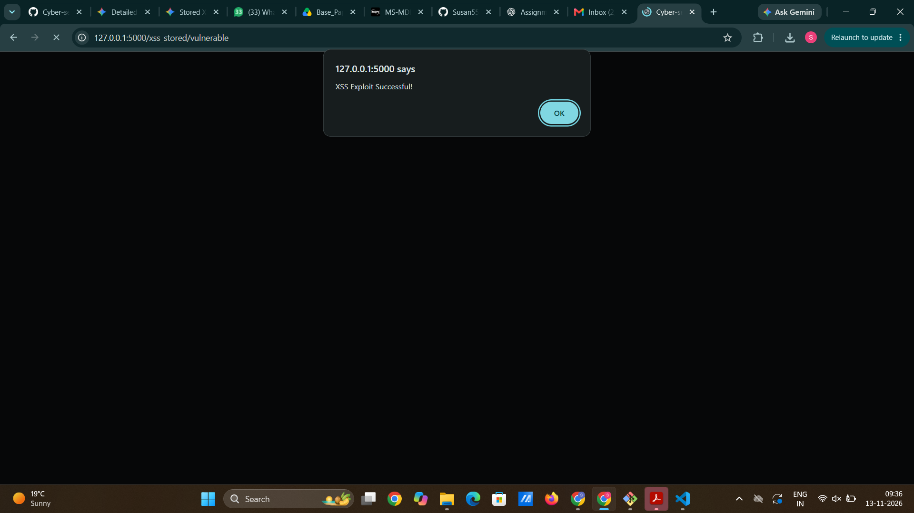
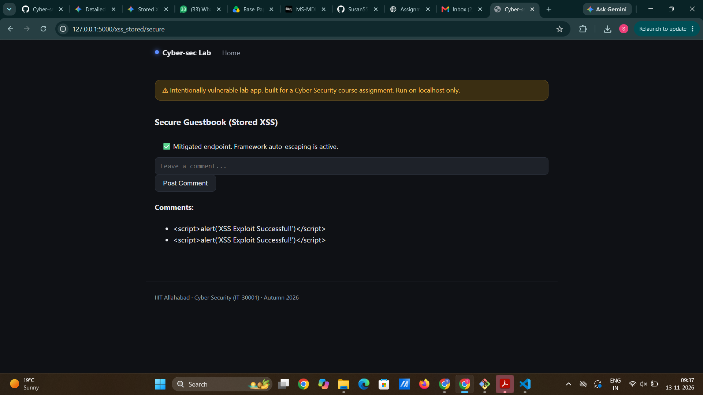

# M2: Cross-Site Scripting - Stored XSS

## (a) Vulnerable implementation

`modules/xss_stored.py`, function `vulnerable()`, route `/xss_stored/vulnerable`. The stored input is rendered directly into the HTML template with Jinja2's `|safe` filter, which explicitly turns off auto-escaping:

```html

    <li>{{ comment|safe }}</li>

```

## (b) Working exploit

Open `http://127.0.0.1:5000/xss_stored/vulnerable`.

**Payload:**

```html
<script>alert('XSS Exploit Successful!')</script>
```

**Execution Flow:**

1. Enter the payload into the comment text field and click **Post Comment**.
2. The payload is stored in the application's backend list (`comments_db`).
3. When the page reloads, the server renders the raw `<script>` tag into the HTML document because of the `|safe` filter.
4. The browser interprets and executes the JavaScript code, displaying an alert dialog box.



## (c) Root cause

User-supplied input is stored in the backend and rendered directly into the HTML page context without output encoding or sanitization. By using the `|safe` filter in Jinja2, the developer instructs the template engine to treat untrusted dynamic input as trusted markup, allowing attackers to inject executable scripts into the browser context of any user viewing the page.

## (d) Mitigation implemented: Framework auto-escaping

`secure()` function at `/xss_stored/secure`:

```html

    <li>{{ comment }}</li>

```

The `|safe` filter was removed. Jinja2's default context-aware auto-escaping is now active. When the exact same payload is rendered, HTML special characters are automatically converted to their corresponding safe HTML entities (e.g., `<` becomes `&lt;` and `>` becomes `&gt;`).

The browser receives the encoded string:

```html
&lt;script&gt;alert('XSS Exploit Successful!')&lt;/script&gt;
```

The payload is displayed harmlessly as literal text on the page rather than being executed as a script. Normal functionality is preserved: posting standard text comments works as expected on the secure route.



## (e) Other mitigations (theory)

* **Context-Aware Output Encoding:** Encoding data differently based on where it appears in the document (HTML body, HTML attributes, JavaScript variables, CSS, or URLs) ensures the browser never confuses data with executable context.
* **Content Security Policy (CSP):** An HTTP response header (e.g., `Content-Security-Policy: default-src 'self'`) that restricts execution of inline scripts and specifies trusted sources for executable content.
* **HTML Sanitization for Rich Text:** If HTML formatting is required, use a vetted sanitization library (such as Bleach or DOMPurify) with a strict allow-list of safe tags and attributes to strip dangerous code.
* **HttpOnly Flag for Cookies:** Setting the `HttpOnly` flag on session cookies prevents client-side scripts from accessing `document.cookie`, mitigating session hijacking risks even if an XSS flaw exists.
