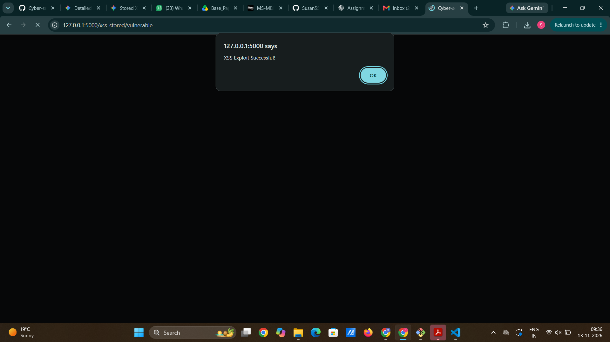
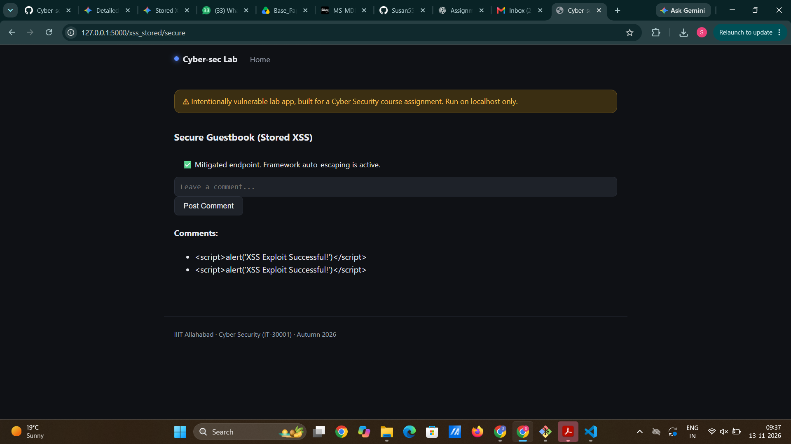

M2: Cross-Site Scripting - Stored XSS

(a) Vulnerable implementation
modules/xss_stored.py, function vulnerable(), route /xss_stored/vulnerable. The stored input is rendered directly into the HTML template with Jinja2's safe filter, which explicitly turns off auto-escaping:

<!-- templates/xss_stored/vulnerable.html -->

    <li class="list-group-item">{{ comment|safe }}</li>


(b) Working exploit
Open http://127.0.0.1:5000/xss_stored/vulnerable.

Payload:

Execution Flow:
1. Enter the payload into the comment text field and click "Post Comment".
2. The payload is stored in the application's backend list (comments_db).
3. When the page reloads, the server renders the raw <script> tag into the HTML document because of the |safe filter.
4. The browser interprets and executes the JavaScript code, displaying an alert dialog box.

(c) Root cause
User-supplied input is stored in the backend and rendered directly into the HTML page context without output encoding or sanitization. By using the |safe filter in Jinja2, the developer instructs the template engine to treat untrusted dynamic input as trusted markup, allowing malicious scripts to execute in the victim's browser context.

(d) Mitigation implemented: Framework auto-escaping
secure() function at /xss_stored/secure:

<!-- templates/xss_stored/secure.html -->

    <li class="list-group-item">{{ comment }}</li>


By removing the |safe filter, Jinja2's default context-aware auto-escaping converts special characters to their safe HTML entity equivalents (e.g., < becomes &lt; and > becomes &gt;). 

When the exact same payload is posted to the secure route, the browser receives:
&lt;script&gt;alert('XSS Exploit Successful!')&lt;/script&gt;

The payload is displayed as harmless literal text on the page rather than being executed as executable script.

The fix does not break normal functionality: posting normal text comments works as expected on the secure route.

(e) Other mitigations (theory)
- Context-Aware Output Encoding: Always encode data based on where it appears in the document (HTML body, HTML attributes, JavaScript variables, CSS, or URLs). For instance, encoding inside an HTML attribute requires escaping quotes (" and ') to prevent escaping the attribute context.
- Content Security Policy (CSP): Implement strong HTTP headers (e.g., Content-Security-Policy: default-src 'self'; script-src 'self'). CSP restricts where scripts can be loaded from and disables inline script execution, preventing attack payloads from executing even if an encoding flaw exists.
- HTML Sanitization for Rich Text: If users legitimately need to submit formatted text/HTML, use a trusted library like Bleach or DOMPurify to parse and sanitize input against a strict allow-list of safe tags (e.g., <b>, <i>) while stripping dangerous tags (<script>, <iframe>, event attributes like onload=).
- HttpOnly Flag for Cookies: Set the HttpOnly attribute on sensitive cookies (like session tokens) so client-side JavaScript cannot read document.cookie, mitigating cookie theft and session hijacking if an XSS vulnerability occurs.