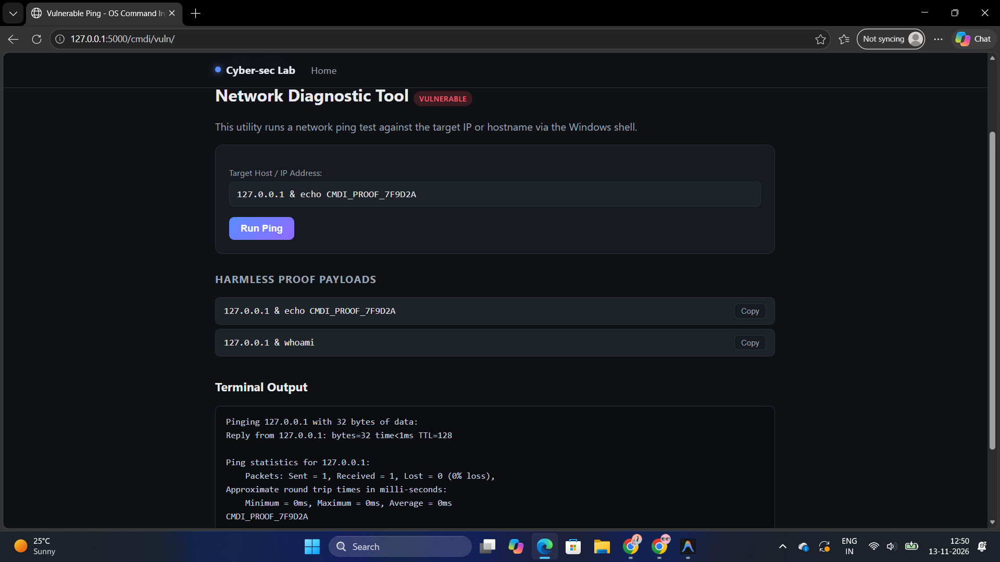
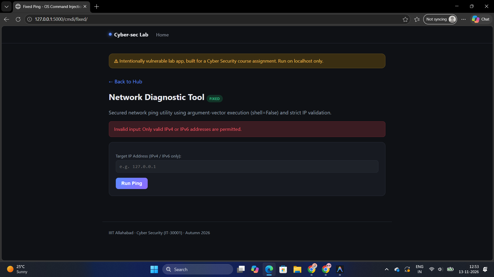

# M3_cmdi

## Vulnerability and Variant
OS Command Injection, In-band (classic) variant. The application builds an operating system command from user input and returns the command's output in the same HTTP response, so the attacker can read the result directly on the page. The vulnerable route `/cmdi/vuln/` is a network ping tool. The fixed route `/cmdi/fixed/` offers the same feature with mitigation applied.


## (a) Vulnerable implementation (file + function)
- **File:** `modules/cmdi.py`
- **Functions:** `vuln_post()` and `execute_ping_vuln(host)`
- **Input Entry Point:** User input enters via the `host` form parameter (`request.form.get("host", "")`). The unvalidated input string is concatenated directly into the shell command string `f"ping -n 1 -w 1000 {host}"` and executed using `subprocess.run(command, shell=True, ...)`.

## (b) Working exploit (exact payload / request)
- **Payload:** `127.0.0.1 & echo CMDI_PROOF_7F9D2A`
- **HTTP Request:**
  ```http
  POST /cmdi/vuln/ HTTP/1.1
  Host: 127.0.0.1:5000
  Content-Type: application/x-www-form-urlencoded

  host=127.0.0.1+%26+echo+CMDI_PROOF_7F9D2A
  ```
- **Observed Output:** The response terminal block displays the single ping reply statistics followed immediately by the executed echo command output:
  ```text
  Pinging 127.0.0.1 with 32 bytes of data:
  Reply from 127.0.0.1: bytes=32 time<1ms TTL=128

  Ping statistics for 127.0.0.1:
      Packets: Sent = 1, Received = 1, Lost = 0 (0% loss),
  Approximate round trip times in milli-seconds:
      Minimum = 0ms, Maximum = 0ms, Average = 0ms
  CMDI_PROOF_7F9D2A
  ```



## (c) Root cause (1-2 lines)
Unsanitized user input is directly concatenated into a shell command string executed with `shell=True`, allowing Windows `cmd.exe` command separators (`&`) to chain and execute arbitrary secondary operating system commands.

## (d) Mitigation implemented (+ screenshot of blocked attempt)
- **Primary Mitigation (Argument-Vector Execution):** In `execute_ping_fixed(host)`, the command is executed as an argument list `["ping", "-n", "1", "-w", "1000", host]` with `shell=False`. Python directly invokes `CreateProcessW` without `cmd.exe`, causing the entire payload to be passed as a literal hostname argument to `ping.exe`.
- **Defence-in-Depth Validation:** In `validate_ip(host)`, the input is stripped and parsed using `ipaddress.ip_address()`, strictly allowing only valid IPv4 and IPv6 addresses.
- **Blocked Result:** When submitting `127.0.0.1 & echo CMDI_PROOF_7F9D2A`, `validate_ip()` raises `ValueError`. The route immediately halts execution without invoking `execute_ping_fixed()`, renders a generic error banner (`Invalid input: Only valid IPv4 or IPv6 addresses are permitted.`), and leaves the input field empty so the payload is not reflected.


- **Evidence the mitigation works on its own:** A Python test called `execute_ping_fixed('127.0.0.1 & echo CMDI_PROOF_7F9D2A')` directly, bypassing the validator. Output: `Ping request could not find host 127.0.0.1 & echo CMDI_PROOF_7F9D2A. Please check the name and try again.`, followed by `TEST PASSED`. The marker appears only inside ping's error message, which repeats the target. It never appears as a standalone output line, so `echo` never ran.




## (e) Other mitigations (theory)
1. **Avoid the Shell:** Never pass user input to a shell interpreter. Without a shell, characters such as `&`, `|`, and `;` have no special meaning, so the input stays a plain argument. The fixed route applies this principle through argument-vector execution (see section (d)).
2. **Least Privilege:** Run the web application under an account with only the permissions it needs, not an administrator account. If injection happens, the attacker inherits only that account's rights, which limits the damage to files, settings, and network access. It doesn't stop injection, but it reduces the impact.
3. **Strict Allowlisting / Type Validation:** Restricting input to strict expected patterns (e.g., IPv4/IPv6 or domain regex). While effective as defence-in-depth, if used as the sole protection with `shell=True`, any flaw in the regex or future requirement change (e.g. allowing hostnames) re-exposes the shell to injection.
4. **Denylisting / Character Stripping:** Attempting to filter dangerous shell metacharacters (`&`, `|`, `;`, `>`, `<`, `$`). This approach is inherently fragile and regularly bypassed using alternative separators, encoding tricks, carets (`^`), or environment variable substitution.
5. **Shell Quoting / Escaping:** Escaping shell control characters before invoking the shell (e.g. `shlex.quote`). This is unreliable on Windows because `cmd.exe` does not follow POSIX quoting semantics and handles carets, percent signs, and quotes differently.
6. **Argument Injection (Parameter Injection):** Even when `shell=False` is used, arguments beginning with `-` or `/` can be misinterpreted by the binary as command-line options (e.g., `-t` for infinite ping or `-l` to adjust buffer size). Validating against strict IP format or rejecting leading option flags ensures operands cannot be abused as configuration switches.
