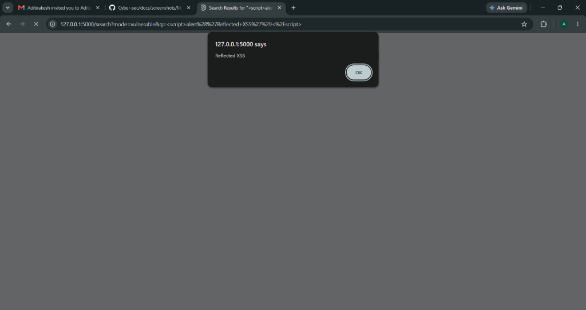
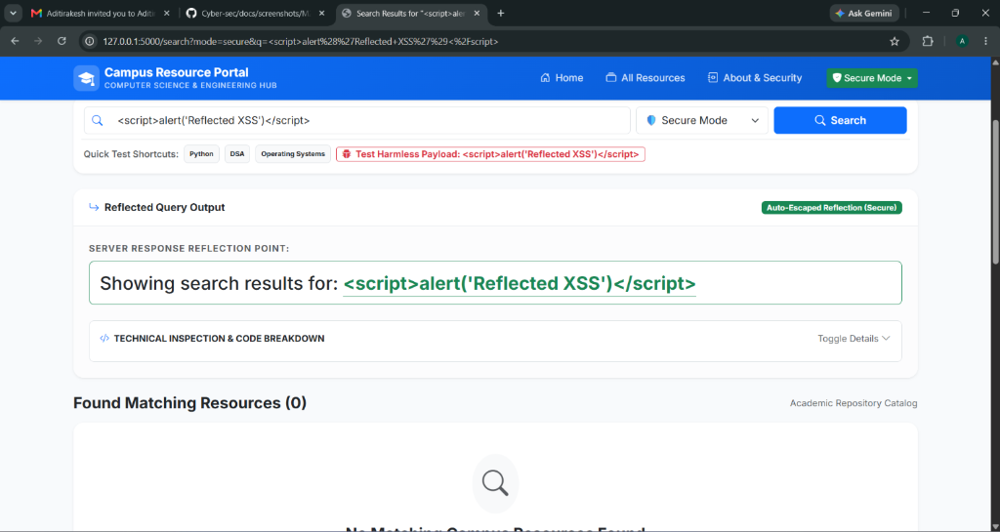

# M4: Cross-Site Scripting - Reflected XSS

## (a) Vulnerable implementation (file + function)

* **File:** `modules/xss_reflected.py`, function `vuln()`, route `/xss_reflected/vuln/`.
* **Template:** `templates/xss_reflected/vuln.html`.

The user's search query received via HTTP GET parameter `q` is reflected directly into the HTML response document using Jinja2's `|safe` filter, which explicitly instructs the template engine to bypass automatic HTML entity escaping:

```html
<!-- Vulnerable reflection point in templates/xss_reflected/vuln.html -->
Showing search results for: 
<span style="color:var(--danger);font-weight:700" id="reflectedTarget">
    {{ query | safe }}
</span>
```

---

## (b) Working exploit (exact payload / request)

Open `http://127.0.0.1:5000/xss_reflected/vuln/` or directly navigate to:

```text
http://127.0.0.1:5000/xss_reflected/vuln/?q=%3Cscript%3Ealert('Reflected+XSS')%3C/script%3E
```

**Payload:**

```html
<script>alert('Reflected XSS')</script>
```

**Execution Flow:**

1. The attacker crafts or victim enters a search request containing the script payload into the `q` URL parameter.
2. The Flask backend extracts `query = request.args.get("q", "")` and passes it to `render_template()`.
3. Because `{{ query | safe }}` is used, Flask emits raw `<script>` tags in the HTTP response:
   ```html
   Showing search results for: <span><script>alert('Reflected XSS')</script></span>
   ```
4. When the victim's browser parses the HTML response, the browser's HTML tokenizer interprets the unencoded tag as executable JavaScript and immediately triggers an alert popup dialog box.



---

## (c) Root cause (1-2 lines)

Untrusted user input from the HTTP request query parameter `q` is reflected directly into the HTML response document without context-aware output encoding. Using the `|safe` filter bypasses Jinja2 auto-escaping, causing the browser parser to interpret user data as executable code.

---

## (d) Mitigation implemented: Framework Context-Aware Auto-Escaping

* **File:** `modules/xss_reflected.py`, function `fixed()`, route `/xss_reflected/fixed/`.
* **Template:** `templates/xss_reflected/fixed.html`.

```html
<!-- Secure reflection point in templates/xss_reflected/fixed.html -->
Showing search results for: 
<span style="color:var(--success);font-weight:700" id="reflectedTarget">
    {{ query }}
</span>
```

The `|safe` filter was removed. Jinja2's default context-aware automatic HTML entity escaping is now active. When the exact same payload is submitted:

* `<` becomes `&lt;`
* `>` becomes `&gt;`
* `&` becomes `&amp;`
* `"` becomes `&#34;`
* `'` becomes `&#39;`

The browser receives the entity-encoded string in the HTTP response:

```html
Showing search results for: <span>&lt;script&gt;alert(&#39;Reflected XSS&#39;)&lt;/script&gt;</span>
```

The browser treats this strictly as printable text. The payload `<script>alert('Reflected XSS')</script>` is displayed safely as literal text on screen, and **zero JavaScript code executes**. Normal search functionality (e.g. searching for `Python`, `DSA`, or `Operating Systems`) remains fully functional.



---

## (e) Other mitigations (theory)

* **Context-Aware Output Encoding:** Encoding data according to the exact destination context (HTML body, HTML attribute, JavaScript variable, CSS, or URL query parameters) to ensure characters cannot break out of their intended syntax boundaries.
* **Content Security Policy (CSP):** An HTTP response header (e.g. `Content-Security-Policy: default-src 'self'`) that restricts the loading and execution of scripts. A strict CSP prevents inline `<script>` blocks from running even if output encoding was accidentally missed.
* **HTML Sanitization for Rich Text:** When applications must accept user-authored HTML formatting (e.g. in markdown or blog posts), use vetted sanitizers such as Python's `bleach` or JavaScript's `DOMPurify` to parse and strip dangerous tags (`<script>`, `<iframe>`) and event handlers (`onload`, `onerror`).
* **HttpOnly Cookie Flag:** Marking sensitive session cookies with `HttpOnly; Secure; SameSite=Lax`. Although this does not prevent XSS execution, it blocks JavaScript from accessing `document.cookie`, mitigating session token theft.
* **Safe DOM Sinks:** When using client-side JavaScript to manipulate the DOM, always use safe properties like `element.textContent` or `element.innerText` rather than unsafe injection sinks such as `element.innerHTML` or `document.write()`.
